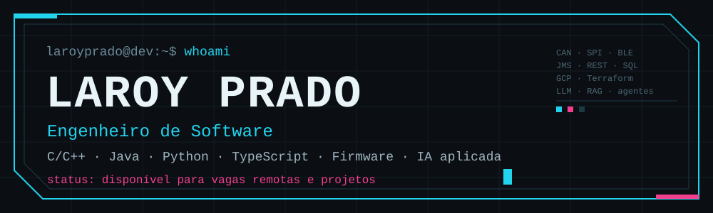
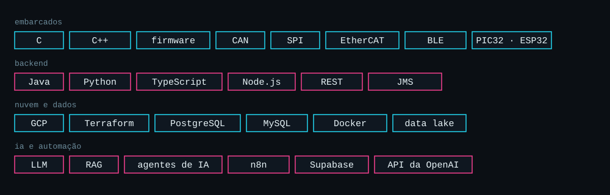
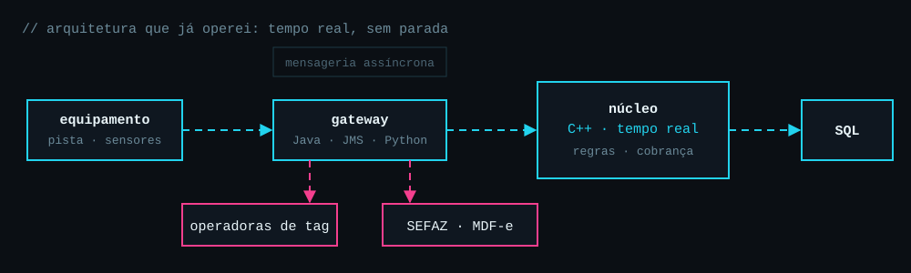
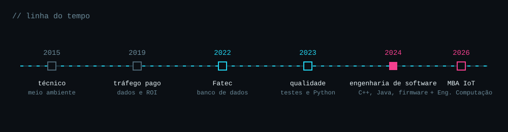

<div align="center">
  
</div>

<br>

<div align="center">
  
</div>

```text
$ cat perfil.txt

nome      : Laroy Prado
função    : Engenheiro de Software
local     : São José dos Campos, SP (Brasil)
foco      : sistemas de tempo real, firmware, integrações, IA aplicada
formação  : MBA em Internet das Coisas (UTFPR) · Eng. de Computação (Univesp) · Tecnólogo em Banco de Dados (Fatec)
modo      : remoto, CLT ou PJ
status    : disponível para vagas e projetos
```

## > sobre

Trabalho com software que não pode parar: sistemas de tempo real em C++, gateways de integração com mensageria, firmware para equipamentos industriais e plataformas web com IA. Gosto de problemas em que um erro tem custo real e de entregar do requisito à implantação.

## > stack

<div align="center">
  
</div>

## > arquitetura que já operei

<div align="center">
  
</div>

<details>
<summary><b>como funciona</b></summary>

<br>

- **equipamento**: sensores e pistas enviam eventos em tempo real.
- **gateway**: serviços em Java (mensageria JMS) e Python recebem os eventos, validam e encaminham, inclusive para operadoras de tag e para a SEFAZ (validação do MDF-e pela placa).
- **núcleo em C++**: aplica as regras e a cobrança, com a exigência de não parar.
- **banco de dados**: registro de tudo o que acontece, com carga e ajustes na implantação.

</details>

## > o que já entreguei

<details open>
<summary><b>sistemas críticos de tempo real</b></summary>

<br>

- Sustentação e evolução, em C++, de um sistema de arrecadação com mais de 20 anos, em operação em tempo real em várias praças do país.
- Coordenação de uma implantação completa em um novo cliente: equipe, alinhamento com o cliente, desenvolvimento, banco de dados e infraestrutura.
- Gateway em Java (JMS) para integração com operadoras de tag e gateway em Python para validar o MDF-e na SEFAZ.

</details>

<details>
<summary><b>embarcados e firmware</b></summary>

<br>

- Módulo de segurança para empilhadeiras: firmware e aplicação desktop com Bluetooth, com cálculo de carga residual a partir de sensores.
- Placa de entradas e saídas analógicas e digitais, entregue ao Canadá e avaliada com nota máxima.
- Aquisitor via CAN bus para uma montadora e firmware de PLC em C.
- Firmware em PIC32 de um equipamento de alto risco para saúde.

</details>

<details>
<summary><b>web, nuvem e IA</b></summary>

<br>

- Plataforma web em TypeScript sobre Google Cloud e Terraform, com assistente de IA (LLM e RAG) e data lake em conformidade com a LGPD.
- Agentes de IA para testes, pentest e resumo diário de entregas.
- Agente de atendimento e vendas por WhatsApp com n8n, Python e Supabase, ligado aos anúncios para medir retorno.

</details>

## > linha do tempo

<div align="center">
  
</div>

## > repositórios públicos

| repositório | linguagem | sobre |
|---|---|---|
| [estudos_linguagem_c](https://github.com/laroyprado/estudos_linguagem_c) | C | estudos de C |
| [vagas_web_scraping_gupy](https://github.com/laroyprado/vagas_web_scraping_gupy) | Python | coleta de vagas da Gupy |
| [02-api-nodejs-rocketseat](https://github.com/laroyprado/02-api-nodejs-rocketseat) | TypeScript | API em Node.js |
| [tdd-stack](https://github.com/laroyprado/tdd-stack) | Java | TDD |
| [dscommerce](https://github.com/laroyprado/dscommerce) | Java | API de e-commerce |
| [gestao_vagas](https://github.com/laroyprado/gestao_vagas) | Java | gestão de vagas |
| [Projeto-API-Equipe-First](https://github.com/laroyprado/Projeto-API-Equipe-First) | Python | projeto integrador, 1º semestre de Banco de Dados |

## > contato

```text
e-mail    laroyprado@gmail.com
linkedin  linkedin.com/in/laroyprado
```

[e-mail](mailto:laroyprado@gmail.com) · [linkedin](https://www.linkedin.com/in/laroyprado/)

<br>

<div align="center">
  
</div>
